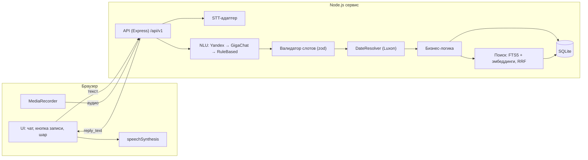

# Вега — голосовой ассистент для задач, напоминаний и встреч

> Из реплики в свободной форме создаёт, находит и показывает задачи, напоминания и встречи и подтверждает действие голосом или текстом.

**Демо:** ещё не задеплоено (см. «Деплой») · **Репозиторий:** — · **ТЗ:** [docs/requirements.pdf](docs/requirements.pdf)

## Что умеет

| Действие | Пример фразы |
|---|---|
| Создать задачу / напоминание | «Напомни мне завтра в 10 утра позвонить Ивану» |
| Создать встречу | «В четверг в 11 у меня встреча с дизайнером» |
| Показать события за период | «Что у меня сегодня?», «Что запланировано на эту неделю?» |
| Найти старую запись | «Я когда-то ставил задачу по договору, найди её» |
| Бонусы: перенос, выполнение, удаление, контекст, конфликты | «Перенеси её на завтра», «Отметь, что отчёт отправлен», «Удали задачу про билеты», пересечение встреч в ответе |

Ввод: голос и текст. Ответ: текст + озвучка браузера. Если данных не хватает, ассистент задаёт один уточняющий вопрос («На какое время поставить встречу?» → «в три»).

## Стек

| Слой | Технология | Почему |
|---|---|---|
| Язык / рантайм | Node.js 20 (ESM) | один язык для фронта и бэка |
| Фронт | ванильный JS, three.js 0.169 (шар) | без сборки, отдаётся тем же сервисом |
| БД | SQLite (better-sqlite3), WAL, FTS5 | файл на volume, полнотекст из коробки |
| LLM | OpenRouter (бесплатные NVIDIA Nemotron 3.5 Super → Lightning → 3 Ultra), YandexGPT, GigaChat, последний слой RuleBased | бесплатный ключ без карты; демо работает и без LLM |
| STT | SpeechKit или Whisper (`STT_PROVIDER`); без ключа — распознавание браузера | голос не ломается без ключей |
| TTS | браузерный `speechSynthesis` (ru-RU), кнопка mute | бесплатно, без задержки |
| Эмбеддинги | Yandex text-search-doc/query | семантический поиск; без ключа — FTS + словарь синонимов |
| Даты | Luxon (таймзона Europe/Moscow) | вся арифметика дат в одном месте |
| Валидация | zod | схема NluResult и тел запросов |
| Хостинг | Fly.io + volume | HTTPS, always-on, SQLite переживает редеплой |

## Архитектура

Фронт → API → NLU (LLM-адаптер) → валидатор слотов → DateResolver → бизнес-логика → SQLite; отдельно STT и TTS.
Полное описание — раздел 02 в [docs/requirements.pdf](docs/requirements.pdf).

Ключевой принцип: **LLM только понимает фразу (intent + слоты), а даты и вычисления делает код.** Модель возвращает «временной объект» (`{"kind":"weekday","weekday":5}`), конкретную дату считает `server/dates/resolver.js` по NOW и таймзоне — поэтому «в пятницу» одинаково понимают YandexGPT, GigaChat и правила, а все 25 кейсов D-1…D-25 покрыты автотестами.



Структура репозитория:

```
server/
  api/        routes.js, middleware.js            — контракт /api/v1, ошибки, X-User-Id, X-Debug-Now, лимиты
  stt/        index.js, yandex.js, whisper.js     — аудио → текст (ffmpeg для SpeechKit)
  nlu/        adapter.js, yandex.js, gigachat.js, rulebased.js, schema.js, prompt.js, normalize.js
  dates/      resolver.js                          — временной объект + NOW → даты
  domain/     type.js                              — правило типа записи (meeting / reminder / task)
  services/   assistant.js, items.js, search.js, embeddings.js, stem.js
  reply/      templates.js                         — шаблоны reply_text
  context/    store.js                             — контекст диалога (TTL 10 минут)
  db/         migrations/001_init.sql, index.js, seed.js
web/          index.html, app.js, api.js, styles.css, orb.js, orb-b.glb, mocks/
scripts/      migrate.js, import_dataset.js, build_embeddings.js, eval_nlu.js, csv.js
data/         seed_mini.json (мини-сид из плана тестов)
docs/         requirements.pdf, eval/phrases.csv, eval/<дата>-<провайдер>.md
test/         dates.test.js, assistant.test.js, api.test.js
```

## Запуск локально

Требования: Node.js ≥ 20; ffmpeg — только для SpeechKit.

```bash
npm install
cp .env.example .env        # ключи можно не заполнять
npm run migrate             # применить миграции
npm run seed                # импорт датасета (data/dataset.clean.csv) или мини-сид
npm run embeddings          # эмбеддинги (нужен ключ Yandex)
npm run dev                 # http://localhost:3000
```

Без ключей LLM приложение работает в режиме RuleBased (базовые фразы). Фронт без бэка: `http://localhost:3000/?mock=1` (ответы из `web/mocks`, сгенерированы реальным пайплайном).

Тесты: `npm test` · NLU-eval: `npm run eval:nlu`

## Переменные окружения

| Переменная | Обязательна | Описание | Пример |
|---|---|---|---|
| `PORT` | нет | порт | `3000` |
| `NODE_ENV` | да | `production` на проде (отключает `X-Debug-Now`) | `production` |
| `DB_PATH` | да | путь к файлу SQLite | `/data/app.db` |
| `TZ_DEFAULT` | нет | таймзона по умолчанию | `Europe/Moscow` |
| `YANDEX_API_KEY` | для LLM/STT/эмбеддингов | API-ключ Yandex Cloud | `AQVN…` |
| `YANDEX_FOLDER_ID` | то же | каталог Yandex Cloud | `b1g…` |
| `YANDEX_LLM_MODEL` | нет | модель | `yandexgpt/latest` |
| `GIGACHAT_AUTH_KEY` | для запасной LLM | ключ авторизации | `…` |
| `GIGACHAT_SCOPE` | то же | scope | `GIGACHAT_API_PERS` |
| `STT_PROVIDER` | да | `yandex` / `whisper` | `yandex` |
| `WHISPER_API_KEY` | если whisper | ключ | `…` |
| `LLM_TIMEOUT_MS` | нет | таймаут LLM | `4000` |
| `RATE_LIMIT_PER_MIN` | нет | лимит запросов на пользователя | `30` |
| `SEED_DEMO` | нет | `0` — не загружать демо-записи в пустую БД | `1` |

`.env` не коммитится. Шаблон — `.env.example`.

## Деплой

Платформа: Fly.io. Один сервис отдаёт API и статику; HTTPS предоставляет платформа.

```bash
fly launch --no-deploy --copy-config
fly volumes create data --size 1 --region ams
fly secrets set YANDEX_API_KEY=... YANDEX_FOLDER_ID=... GIGACHAT_AUTH_KEY=...
fly deploy
```

- Volume смонтирован в `/data`, `DB_PATH=/data/app.db`.
- При пустой БД автоматически выполняется сид (пользователь `demo`).
- Проверка: `GET /api/v1/health`.
- Прогрев перед показом не нужен: `min_machines_running = 1`, `auto_stop_machines = "off"`.

## Как пользоваться

1. Откройте ссылку по HTTPS и разрешите доступ к микрофону.
2. Нажмите кнопку записи (или удерживайте пробел), скажите фразу, нажмите ещё раз.
3. Расшифровка появится в чате, затем ответ ассистента (текст + озвучка).
4. Если голос недоступен, введите фразу в поле ввода — оно подсветится.
5. Если ассистенту не хватает данных, он задаст вопрос. Ответьте обычной фразой («в три») или кнопкой под чатом.

Примеры фраз: «Напомни мне завтра в 10 утра позвонить Ивану», «В пятницу нужно отправить отчёт», «Поставь задачу купить билеты до конца недели», «Добавь встречу с командой завтра в 15:00», «Поставь встречу с Иваном завтра» → «в три», «Что у меня сегодня?», «Что запланировано на эту неделю?», «Найди задачу про презентацию», «Когда у меня была встреча с Иваном?», «Перенеси её на завтра».

Пользователь: по умолчанию `demo` (видны демо-записи); `?user=new` создаёт личный анонимный id.

## API

Контракт — раздел 03 в [docs/requirements.pdf](docs/requirements.pdf). Основные: `POST /api/v1/assistant/message`, `POST /api/v1/assistant/voice`, `GET /api/v1/events`, `GET /api/v1/search`; без LLM: `POST /tasks`, `POST /meetings`, `PATCH /tasks/:id`, `DELETE /tasks/:id`, `PATCH /tasks/:id/complete`, `GET /health`.

```bash
curl -X POST http://localhost:3000/api/v1/assistant/message \
  -H "Content-Type: application/json" -H "X-User-Id: demo" \
  -d '{"text":"Что у меня сегодня?","session_id":"s1"}'
```

## Решения, принятые самостоятельно

| Решение | Альтернатива | Почему так |
|---|---|---|
| Даты считает код, LLM возвращает структуру | LLM считает даты | детерминизм, тестируемость (D-1…D-25 зелёные) |
| Локальные дата/время как источник истины + производный UTC | только UTC | запросы по дню, задачи без времени |
| Гибридный поиск (FTS5 + эмбеддинги, RRF) | только FTS / только вектор | без ключа деградирует до FTS + словаря синонимов; сравнение режимов — после подключения ключа |
| Три слоя NLU (Yandex → GigaChat → правила) | одна LLM | демо работает с выключенными LLM (E-4) |
| Тип записи определяется правилом, а не LLM | LLM решает | предсказуемость (глоссарий, раздел 2) |
| Один сервис (API + статика) | Vercel + отдельный бэк | без CORS, один деплой |
| Шаблонные ответы | LLM генерирует ответ | скорость, контроль, тесты на точный текст |
| Стеммер Snowball (snowball-stemmers) | natural PorterStemmerRu | один стеммер для индекса и запроса |
| Без ключа STT — расшифровка браузера | только текст | голос работает в Chrome и без ключей |
| Неоднозначная цель при переносе/закрытии → берём единственную предстоящую | всегда переспрашивать | «перенеси встречу с дизайнером» не путается с прошедшей |

## Качество

| Метрика | Значение |
|---|---|
| Intent accuracy (n=65, RuleBased) | 100% |
| Strict accuracy (n=65, RuleBased) | 100% |
| Clarification precision / recall | 100% / 100% |
| Время ответа p95 (текст, без LLM) | < 10 мс на пайплайн |
| Поиск: precision@3 fts / semantic / hybrid | не измерено: нет ключа эмбеддингов |

Набор — стартовые 65 фраз из ТЗ (`docs/eval/phrases.csv`), не скрытый hold-out; цифры оптимистичны. Отчёт: `docs/eval/`. Автотесты: 102 (DateResolver D-1…D-25, сценарии T/U/S/B, ошибки E-1…E-15, контракт REST).

## Что улучшили бы при наличии времени

- Повторяющиеся задачи и встречи
- Интеграция с реальным календарём (Google/Яндекс, ICS)
- Подтверждение конфликтов встреч диалогом («Всё равно поставить?», FR-2.5)
- Уведомления о напоминаниях (push)
- Аутентификация и полноценный multi-user
- Потоковое распознавание и ответ без паузы

## Известные ограничения

- «В пятницу» в пятницу = следующая пятница
- Только русский язык
- Браузерный TTS зависит от установленных голосов; без ru-RU — ответ только текстом
- Распознавание до 30 с
- Адаптеры YandexGPT, GigaChat, SpeechKit, Whisper и эмбеддингов написаны по документации, но без ключей не проверены на живых сервисах
- Датасет на 1000 записей не подключён: используется мини-сид из плана тестов (даты записей 201–210 подобраны вручную)

## Команда

Максон — бэкенд · Варя — аналитика · Катя — продукт · Рома П. — UX/UI · Вова — дизайн · Рома П. — проект

## Документация

[ТЗ: глоссарий, требования, архитектура, API, данные, NLU, тесты, план, шаблон README](docs/requirements.pdf) · [NLU-eval](docs/eval/)

## Интерфейс: что показать на демо

- **Чаты на орбите → по темам.** Прокрутите за чат: чаты прилетают на орбиту шара. Когда они сядут, шар начинает «биться» и зовёт нажать. Нажатие раскладывает чаты по колонкам «Встречи / Задачи и напоминания / Планы и поиск / Разное» (тема определяется по действиям в чате). Повторное нажатие или Esc возвращает орбиту.
- **«Как я понял».** Под каждым ответом раскрывается разбор: намерение, уверенность NLU, извлечённые слоты и дата, посчитанная кодом (`meta.nlu` в ответе API).
- **Живые напоминания.** Когда наступает срок записи из плана, сверху всплывает тост («Готово» / «+10 мин»), и шар произносит напоминание. Для демо: `assistant.demoReminder()` в консоли.
- `?debug` включает ручной шаг анимации орбиты (`__orbit.frame()`) для проверки кадров.
