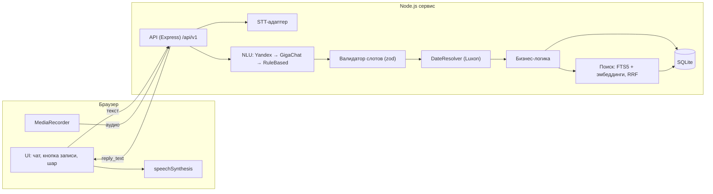

# Вега — голосовой ассистент для задач, напоминаний и встреч

> Из реплики в свободной форме создаёт, находит и показывает задачи, напоминания и встречи и подтверждает действие голосом или текстом.

**Демо:** https://vega-assistant.onrender.com (free-тариф: после простоя первый запрос ~1 мин) · **Репозиторий:** https://github.com/masqquta/vega-voice-assistant · **ТЗ:** [docs/requirements.pdf](docs/requirements.pdf)

## Что умеет

| Действие | Пример фразы |
|---|---|
| Создать задачу / напоминание | «Напомни мне завтра в 10 утра позвонить Ивану» |
| Создать встречу | «В четверг в 11 у меня встреча с дизайнером» |
| Показать события за период | «Что у меня сегодня?», «Что запланировано на эту неделю?» |
| Найти старую запись | «Я когда-то ставил задачу по договору, найди её» |
| Бонусы: перенос, выполнение, удаление, контекст, конфликты | «Перенеси её на завтра», «Отметь, что отчёт отправлен», «Удали задачу про билеты», пересечение встреч в ответе |
| Бонус: календарь | кнопка «В календарь» → ссылка-подписка `.ics` для Google / Яндекс / Apple / Outlook, задачи появляются там сами |

Ввод: голос и текст. Ответ: текст + озвучка браузера. Если данных не хватает, ассистент задаёт один уточняющий вопрос («На какое время поставить встречу?» → «в три»).

## Стек

| Слой | Технология | Почему |
|---|---|---|
| Язык / рантайм | Node.js 24 (ESM) | один язык для фронта и бэка |
| Фронт | ванильный JS, three.js 0.169 (шар) | без сборки, отдаётся тем же сервисом |
| БД | SQLite (better-sqlite3), WAL, FTS5 | файл на volume, полнотекст из коробки |
| LLM | OpenRouter (бесплатные NVIDIA Nemotron 3.5 Super → Lightning → 3 Ultra), YandexGPT, GigaChat, последний слой RuleBased | бесплатный ключ без карты; демо работает и без LLM |
| STT | SpeechKit или Whisper (`STT_PROVIDER`); без ключа — распознавание браузера | голос не ломается без ключей |
| TTS | браузерный `speechSynthesis` (ru-RU), кнопка mute | бесплатно, без задержки |
| Эмбеддинги | локальная multilingual-e5-small (Transformers.js, ONNX, q8); с ключом — Yandex text-search | поиск по смыслу без ключей и лимитов, модель внутри сервиса |
| Даты | Luxon (таймзона Europe/Moscow) | вся арифметика дат в одном месте |
| Валидация | zod | схема NluResult и тел запросов |
| Хостинг | Render (free, Docker) | HTTPS без карты; запасной вариант — Fly.io + volume |

## Архитектура

Фронт → API → NLU (LLM-адаптер) → валидатор слотов → DateResolver → бизнес-логика → SQLite; отдельно STT и TTS.
Полное описание — раздел 02 в [docs/requirements.pdf](docs/requirements.pdf).

Ключевой принцип: **LLM только понимает фразу (intent + слоты), а даты и вычисления делает код.** Модель возвращает «временной объект» (`{"kind":"weekday","weekday":5}`), конкретную дату считает `server/dates/resolver.js` по NOW и таймзоне — поэтому «в пятницу» одинаково понимают YandexGPT, GigaChat и правила, а все 25 кейсов D-1…D-25 покрыты автотестами.



Структура репозитория:

```
server/
  api/        routes.js, middleware.js            — контракт /api/v1, ошибки, X-User-Id, X-Debug-Now, лимиты
  stt/        index.js, yandex.js, whisper.js     — аудио → текст (ffmpeg для SpeechKit)
  nlu/        adapter.js, yandex.js, gigachat.js, rulebased.js, schema.js, prompt.js, normalize.js
  dates/      resolver.js                          — временной объект + NOW → даты
  domain/     type.js                              — правило типа записи (meeting / reminder / task)
  services/   assistant.js, items.js, search.js, embeddings.js, stem.js
  reply/      templates.js                         — шаблоны reply_text
  context/    store.js                             — контекст диалога (TTL 10 минут)
  db/         migrations/001_init.sql, index.js, seed.js
web/          index.html, app.js, api.js, styles.css, orb.js, orb-b.glb, mocks/
scripts/      migrate.js, import_dataset.js, build_embeddings.js, eval_nlu.js, csv.js
data/         seed_mini.json (мини-сид из плана тестов)
docs/         requirements.pdf, eval/phrases.csv, eval/<дата>-<провайдер>.md
test/         dates.test.js, assistant.test.js, api.test.js
```

## Запуск локально

Требования: Node.js ≥ 22; ffmpeg — только для SpeechKit.

```bash
npm install
cp .env.example .env        # ключи можно не заполнять
npm run migrate             # применить миграции
npm run clean               # (уже сделано) очистка датасета ТЗ: data/raw → data/dataset.clean.csv
npm run seed                # демо-сценарии + импорт 1000 записей датасета
npm run embeddings          # эмбеддинги (нужен ключ Yandex)
npm run dev                 # http://localhost:3000
```

Для понимания свободных фраз достаточно бесплатного ключа OpenRouter (`OPENROUTER_API_KEY`, без карты: https://openrouter.ai/keys). Без ключей LLM приложение работает в режиме RuleBased (базовые фразы). Фронт без бэка: `http://localhost:3000/?mock=1` (ответы из `web/mocks`, сгенерированы реальным пайплайном).

Тесты: `npm test` · NLU-eval: `npm run eval:nlu`

## Переменные окружения

| Переменная | Обязательна | Описание | Пример |
|---|---|---|---|
| `PORT` | нет | порт | `3000` |
| `NODE_ENV` | да | `production` на проде (отключает `X-Debug-Now`) | `production` |
| `DB_PATH` | да | путь к файлу SQLite | `/data/app.db` |
| `TZ_DEFAULT` | нет | таймзона по умолчанию | `Europe/Moscow` |
| `OPENROUTER_API_KEY` | для LLM (основная) | ключ OpenRouter | `sk-or-v1-…` |
| `OPENROUTER_MODELS` | нет | модели через запятую, следующая — запасная | `nvidia/nemotron-3.5-super-vl:free,…` |
| `YANDEX_API_KEY` | для LLM/STT/эмбеддингов | API-ключ Yandex Cloud | `AQVN…` |
| `YANDEX_FOLDER_ID` | то же | каталог Yandex Cloud | `b1g…` |
| `YANDEX_LLM_MODEL` | нет | модель | `yandexgpt/latest` |
| `GIGACHAT_AUTH_KEY` | для запасной LLM | ключ авторизации | `…` |
| `GIGACHAT_SCOPE` | то же | scope | `GIGACHAT_API_PERS` |
| `STT_PROVIDER` | да | `yandex` / `whisper` | `yandex` |
| `WHISPER_API_KEY` | если whisper | ключ | `…` |
| `LLM_TIMEOUT_MS` | нет | таймаут LLM | `8000` |
| `NLU_CASCADE` | нет | `0` — всегда спрашивать LLM (для сравнения в eval) | `1` |
| `EMBEDDINGS` | нет | `local` (по умолчанию) / `yandex` / `off` | `local` |
| `SEM_THRESHOLD` | нет | порог сходства для поиска по смыслу | `0.82` |
| `RATE_LIMIT_PER_MIN` | нет | лимит запросов на пользователя | `30` |
| `SEED_DEMO` | нет | `0` — не загружать демо-записи в пустую БД | `1` |

`.env` не коммитится. Шаблон — `.env.example`.

## Деплой

Платформа: **Render** (бесплатный тариф, без карты). Один сервис из `Dockerfile` отдаёт API и статику; HTTPS (нужен для микрофона) даёт платформа. Конфиг — [render.yaml](render.yaml).

1. Render → New → Blueprint → этот репозиторий.
2. Вписать секрет `OPENROUTER_API_KEY`.
3. Deploy. Проверка: `GET /api/v1/health`.

- Диск на free-тарифе временный: при каждом старте контейнер заново импортирует демо-сценарии и датасет (импорт идемпотентен), созданные в демо записи живут до перезапуска.
- Free-сервис засыпает после 15 минут без запросов; первый запрос будит его ~1 минуту — перед показом откройте ссылку заранее.
- Для постоянного хранения есть [fly.toml](fly.toml) (Fly.io + volume `/data`, always-on), но Fly.io требует карту.

## Голос

| Шаг | Как сделано | Без ключей |
|---|---|---|
| Запись | `MediaRecorder` (webm/opus), кнопка микрофона, пробел (push-to-talk) или нажатие на шар — режим «свободные руки»: пауза 1,4 с после фразы → отправка | — |
| Распознавание | на сервере SpeechKit или Whisper (`POST /assistant/voice`) | параллельно идёт распознавание браузера (Web Speech API, Chrome/Edge/Яндекс Браузер) — оно и используется; живая расшифровка видна во время речи |
| Ответ голосом | `speechSynthesis`, выбирается самый естественный русский голос: нейросетевые Edge («Светлана/Дарья Online (Natural)») → Google → любой ru-RU | бесплатно; без ru-голоса — только текст |
| Сбои | нет микрофона / нет HTTPS / не распознано → понятная подсказка и подсвеченное поле ввода | — |

Лучше всего звучит в **Microsoft Edge** (нейросетевые голоса). В Firefox нет Web Speech API — без ключа STT голосовой ввод там недоступен, работает текст.

## Как пользоваться

1. Откройте ссылку по HTTPS и разрешите доступ к микрофону.
2. Нажмите кнопку записи (или удерживайте пробел), скажите фразу, нажмите ещё раз.
3. Расшифровка появится в чате, затем ответ ассистента (текст + озвучка).
4. Если голос недоступен, введите фразу в поле ввода — оно подсветится.
5. Если ассистенту не хватает данных, он задаст вопрос. Ответьте обычной фразой («в три») или кнопкой под чатом.

Примеры фраз: «Напомни мне завтра в 10 утра позвонить Ивану», «В пятницу нужно отправить отчёт», «Поставь задачу купить билеты до конца недели», «Добавь встречу с командой завтра в 15:00», «Поставь встречу с Иваном завтра» → «в три», «Что у меня сегодня?», «Что запланировано на эту неделю?», «Найди задачу про презентацию», «Когда у меня была встреча с Иваном?», «Перенеси её на завтра».

Пользователь: по умолчанию `demo` (видны демо-записи); `?user=new` создаёт личный анонимный id.

## API

Контракт — раздел 03 в [docs/requirements.pdf](docs/requirements.pdf). Основные: `POST /api/v1/assistant/message`, `POST /api/v1/assistant/voice`, `GET /api/v1/events`, `GET /api/v1/search`; без LLM: `POST /tasks`, `POST /meetings`, `PATCH /tasks/:id`, `DELETE /tasks/:id`, `PATCH /tasks/:id/complete`, `GET /health`.

```bash
curl -X POST http://localhost:3000/api/v1/assistant/message \
  -H "Content-Type: application/json" -H "X-User-Id: demo" \
  -d '{"text":"Что у меня сегодня?","session_id":"s1"}'
```

## Решения, принятые самостоятельно

| Решение | Альтернатива | Почему так |
|---|---|---|
| Даты считает код, LLM возвращает структуру | LLM считает даты | детерминизм, тестируемость (D-1…D-25 зелёные) |
| Локальные дата/время как источник истины + производный UTC | только UTC | запросы по дню, задачи без времени |
| Гибридный поиск (FTS5 + эмбеддинги, RRF) | только FTS / только вектор | гибрид лучше обоих режимов по отдельности (85% против 45% и 80%, см. «Качество»); без эмбеддингов деградирует до FTS + словаря синонимов |
| Цепочка NLU (OpenRouter → Yandex → GigaChat → правила) | одна LLM | демо работает с выключенными LLM (E-4) |
| OpenRouter, бесплатные NVIDIA Nemotron без reasoning | платные GPT/Claude | бесплатно и без карты; без «размышлений» ответ ~1 с вместо 10–15 с; в списке моделей следующая подхватывает, если первая перегружена |
| Очистка датасета правилами (падежи, тип, статус) | LLM переписывает записи | детерминированно, отчёт о каждой правке — [data/clean_report.md](data/clean_report.md) |
| Тип записи определяется правилом, а не LLM | LLM решает | предсказуемость (глоссарий, раздел 2) |
| Каскад: правила отвечают сами на «чистых» фразах, остальное — LLM | LLM на каждую фразу | ответ за миллисекунды, бесплатный лимит LLM (50 запросов/сутки) тратится в 3–5 раз медленнее; признаки «грязной» фразы (разговорные вставки, «полтора», «30-е», опечатка в дне недели, вопрос вместо команды) подобраны по ошибкам правил на замере |
| Локальная модель эмбеддингов вместо API | Yandex / OpenAI Embeddings | без ключей и лимитов, данные не уходят наружу; порог сходства у e5 свой (0.82) — подобран замером |
| Календарь — подписка .ics по ссылке | OAuth-интеграция с Google | работает с любым календарём без авторизации; односторонняя (Вега → календарь) |
| Один сервис (API + статика) | Vercel + отдельный бэк | без CORS, один деплой |
| Шаблонные ответы | LLM генерирует ответ | скорость, контроль, тесты на точный текст |
| Стеммер Snowball (snowball-stemmers) | natural PorterStemmerRu | один стеммер для индекса и запроса |
| Без ключа STT — расшифровка браузера | только текст | голос работает в Chrome и без ключей |
| Неоднозначная цель при переносе/закрытии → берём единственную предстоящую | всегда переспрашивать | «перенеси встречу с дизайнером» не путается с прошедшей |

## Качество

Два набора фраз (`npm run eval:nlu -- <набор>`), NOW = ср 21.10.2026 14:30:

| Набор | Правила (RuleBased) | Каскад правила → LLM | Уходит в LLM |
|---|---|---|---|
| Базовый: 65 фраз из ТЗ (`docs/eval/phrases.csv`) | strict 100% | <!-- eval:base --> замер ночью (лимит free-LLM) | 17% |
| Сложный: 40 «живых» фраз — разговорные, опечатки, «полтора часа», «на выходных», поиск без общих слов (`docs/eval/phrases_hard.csv`) | intent 82.5%, strict 67.5% | <!-- eval:hard --> замер ночью (лимит free-LLM) | 60% |

Правила ошибаются со списками («чё там по планам на выходные?» — 17%) и поиском (50%); каскад отправляет такие фразы в LLM, а «чистые» оставляет правилам — среди оставленных ошибок нет ни на одном наборе.

Поиск старых записей (`npm run eval:search`): база — мини-сид + датасет ТЗ (1010 записей), 20 запросов-перефразировок без общих слов с записью («встреча по деньгам» → «…по бюджету», «соревнование программистов» → «хакатон») и 4 запроса «мимо базы»:

| Режим | Hit@1 | Hit@3 | «Ничего нет», когда нет |
|---|---|---|---|
| Только слова (FTS5 + синонимы) | 45% | 45% | 100% |
| Только смысл (эмбеддинги) | 80% | 80% | 100% |
| **Гибрид (RRF)** | **85%** | **85%** | **100%** |

| Ещё | Значение |
|---|---|
| Clarification precision / recall (базовый) | 100% / 100% |
| Время ответа: правила / LLM (OpenRouter, Nemotron) | < 10 мс / ~0,7–1,5 с |
| Векторы для 1000 записей (локальная модель, CPU) | ~4 с при старте, фоном |

Отчёты: [docs/eval/](docs/eval/). Наборы не скрытый hold-out: признаки каскада подобраны по ошибкам правил на сложном наборе, порог поиска — на тех же 24 запросах, поэтому цифры оптимистичны; следующий шаг — отдельный скрытый набор. Автотесты: 106 (DateResolver D-1…D-25, сценарии T/U/S/B, ошибки E-1…E-15, контракт REST, формат .ics).

## Что улучшили бы при наличии времени

- Повторяющиеся задачи и встречи
- Двусторонняя синхронизация с календарём (сейчас подписка .ics только Вега → календарь)
- Скрытый набор фраз и запросов для честной оценки (без подгонки порогов)
- Подтверждение конфликтов встреч диалогом («Всё равно поставить?», FR-2.5)
- Уведомления о напоминаниях (push)
- Аутентификация и полноценный multi-user
- Потоковое распознавание и ответ без паузы

## Известные ограничения

- «В пятницу» в пятницу = следующая пятница
- Только русский язык
- Браузерный TTS зависит от установленных голосов; без ru-RU — ответ только текстом
- Распознавание до 30 с
- Адаптер OpenRouter проверен на живом сервисе; адаптеры YandexGPT, GigaChat, SpeechKit, Whisper и эмбеддингов написаны по документации, но без ключей не проверены
- Бесплатные модели OpenRouter имеют дневной лимит запросов и иногда перегружены — тогда отвечает следующая модель или RuleBased
- Датасет из ТЗ (1000 записей) очищен правилами и загружается пользователю `demo` вместе с демо-сценариями; прошедшие записи помечены выполненными

## Команда

Максон — бэкенд: подключение LLM (OpenRouter, каскад правила → LLM), оценка качества NLU и поиска, поиск по смыслу на локальной модели, очистка датасета, экспорт в календарь, деплой · Варя — аналитика · Катя — продукт · Рома П. — UX/UI · Вова — дизайн · Рома П. — проект

## Документация

[ТЗ: глоссарий, требования, архитектура, API, данные, NLU, тесты, план, шаблон README](docs/requirements.pdf) · [NLU-eval](docs/eval/)

## Интерфейс: что показать на демо

- **Чаты на орбите → по темам.** Прокрутите за чат: чаты прилетают на орбиту шара. Когда они сядут, шар начинает «биться» и зовёт нажать. Нажатие раскладывает чаты по колонкам «Встречи / Задачи и напоминания / Планы и поиск / Разное» (тема определяется по действиям в чате). Повторное нажатие или Esc возвращает орбиту.
- **«Как я понял».** Под каждым ответом раскрывается разбор: намерение, уверенность NLU, извлечённые слоты и дата, посчитанная кодом (`meta.nlu` в ответе API).
- **Живые напоминания.** Когда наступает срок записи из плана, сверху всплывает тост («Готово» / «+10 мин»), и шар произносит напоминание. Для демо: `assistant.demoReminder()` в консоли.
- `?debug` включает ручной шаг анимации орбиты (`__orbit.frame()`) для проверки кадров.
